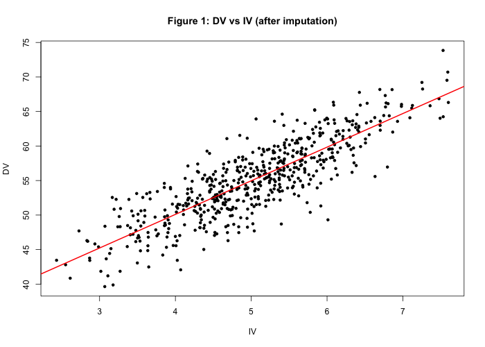
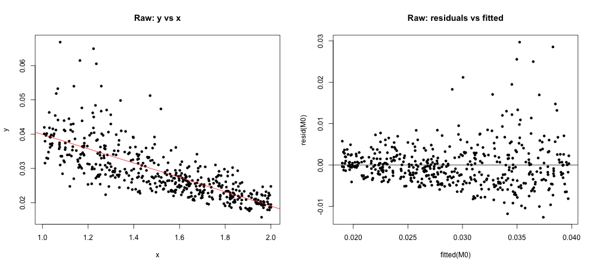
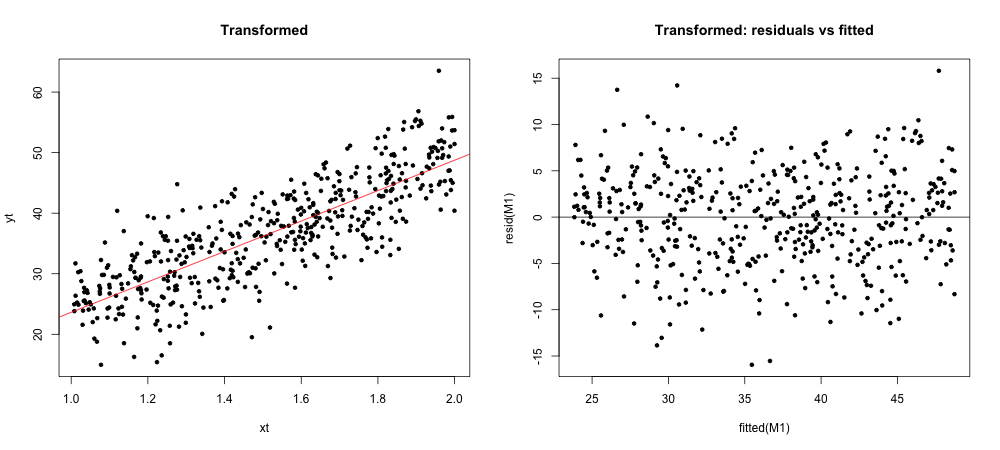

# One-Predictor Linear Regression: Missing Data Imputation & Model Fitting

Statistical analysis project for **AMS 315 (Data Analysis), Stony Brook University, Fall 2026**, done in R.

## Overview

**Part A: data cleaning and missing data.** Two files (independent variable and dependent variable, keyed by subject ID) are sorted and merged programmatically. I count the missing values in each variable and fill them in with multiple imputation (`mice`, bootstrap linear regression). A simple linear regression is then fitted to the completed data.

**Part B: model recovery.** The goal is to recover the function that generated the dependent variable. I compare variable transformations by R² and by residual diagnostics. Near-repeated x values are binned so that an approximate lack-of-fit (pure error) F-test can be run on the chosen model.

## Skills demonstrated
- Data wrangling: merging keyed datasets, auditing missing data
- Multiple imputation (MICE)
- OLS regression: ANOVA, confidence intervals, hypothesis testing on the slope
- Regression diagnostics: residual analysis, variable transformations (Box-Cox style)
- Lack-of-fit testing with binned replicates

## Repo layout
```
run_all.R        runs the full analysis and saves all console output
R/partA.R        merge, missing-data audit, imputation, regression
R/partB.R        transformation search, regression, binning, LOF test
data/            input data (anonymized file names) + merged/imputed CSVs
figures/         plots produced by the scripts
output/          full console output from each part (partA_output.txt, partB_output.txt)
report/          final write-up (PDF)
```

## How to run
1. Install R and RStudio.
2. Open the project folder in RStudio and install the packages (one time only):
   ```r
   install.packages(c("mice", "remotes"))
   remotes::install_github("cran/alr3")
   ```
3. Open `run_all.R` and click **Source**. It reproduces every result in one step:
   - runs `R/partA.R` and then `R/partB.R`
   - saves the merged and imputed data to `data/`
   - saves all plots to `figures/`
   - records the full printed output (tables, model summaries, tests) to `output/`

A fixed random seed (`set.seed(315)`) makes the imputation results reproducible.

## Key results

### Part A: missing data and regression
- Merged **569** subject records. 500 had an IV value and 520 had a DV value (**12.1%** and **8.6%** missing), 454 had both, and 3 had neither.
- Dropped the 3 records with no data and imputed the remaining gaps with MICE (`norm.boot`), giving 566 complete records.
- Fitted model: **DV = 30.62 + 4.87 · IV**, with **R² = 0.717**.
- The slope is highly significant: F(1, 564) = 1428.9, p < 2.2 × 10⁻¹⁶, 95% CI (4.62, 5.12).



### Part B: finding the generating function
- The raw linear fit gave R² = 0.561, and its residual plot showed a **funnel shape** (non-constant variance).
- I compared 25 combinations of x and y transformations. A **reciprocal transformation (1/y)** gave the best simple model, raising **R² to 0.660** and producing an even, patternless residual band.
- Fitted model: **1/y = −1.48 + 25.11 · x**, so **y = 1 / (−1.48 + 25.11 · x)**.
- The slope is highly significant: F(1, 472) = 916.98, p < 2.2 × 10⁻¹⁶, 95% CI (23.48, 26.74).
- I binned x into 19 groups for a lack-of-fit test, which showed **no significant lack of fit** (F(17, 455) = 1.34, p = 0.164).
- The intercept was not significant (p = 0.247), which suggests the true function may be close to **y = 1/(25x)**.




The full write-up is in [`report/AMS315_Project1_Report.pdf`](report/AMS315_Project1_Report.pdf). The project received a grade of 100/100.
